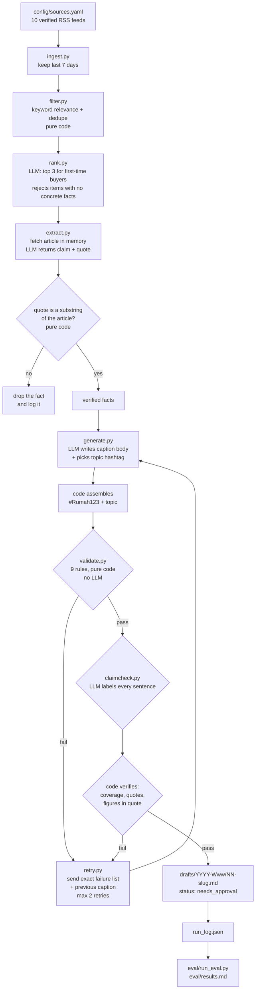

# Weekly IG Post Generator for Rumah123

Turns the week's Indonesian property news into Instagram caption drafts for
first-time home buyers aged 25 to 34 in Greater Jakarta.

Every caption is grounded in a quote from a real article, checked by code, and
left as a draft with status `needs_approval`. Nothing is posted anywhere.

## What it does

Once a week it reads Indonesian property and personal-finance RSS feeds, picks
the three stories most useful to a first-time buyer, pulls the verifiable facts
out of each article, writes three caption variants per story in Indonesian, and
rejects any caption whose figures are not in the verified facts.

Output is a markdown draft per story in `drafts/YYYY-Www/`, plus a
`run_log.json` recording what actually happened, and `eval/results.md` scoring
the run.

## Architecture



## Why validation is code and not an LLM self-check

Every rule that can be checked mechanically is checked mechanically. The model
is never asked whether its own caption obeys the rules.

The reason is concrete. In earlier prompt-engineering work the model reported a
word count of 79 for a caption that was actually about 89 words. A model asked
to audit itself will agree with itself. So counting, quote verification and
number grounding live in `src/validate.py` and `src/textutil.py`, where they
are deterministic and unit-tested.

The LLM is used for the four things that genuinely need judgement: ranking,
extracting candidate facts, writing Indonesian copy, and reading a caption
sentence by sentence. Everything it returns is then verified:

| The model says | Code verifies |
| --- | --- |
| here is a supporting quote | the quote is a substring of the fetched article |
| this caption is 85 words | counts whitespace tokens after removing hashtags |
| this claim is supported | the cited quote exists in the verified facts |
| this claim is supported | every figure in the claim appears in that quote |
| this sentence is just voice | re-checks it for digits, institutions, trend verbs |
| here are the caption's claims | the sentences returned cover the whole caption |

This caught real errors during development. The claim check marked a sentence
supported while citing a quote that did not exist in the facts, and it labelled
`"Bank Indonesia menahan suku bunga."` as non-factual voice. Both were rejected
by code, not by a better prompt.

## Setup

Python 3.11 or newer. Developed on 3.12.2.

```bash
python3 -m venv .venv
.venv/bin/python -m pip install -r requirements.txt

cp .env.example .env
# edit .env:
#   OPENAI_API_KEY=sk-...
#   OPENAI_MODEL=gpt-4.1-mini
```

`.env` is gitignored. Put real values there and never in `.env.example`, which
is tracked. A test fails if a key ever appears in the template.

The model is not hardcoded anywhere in `src/`. It is read from `OPENAI_MODEL`,
and `test_no_model_name_is_hardcoded_in_src` asserts that.

### Why this model

All ten candidate models on the key were probed with a real strict
`json_schema` call before choosing. Every one supported it. `gpt-4.1-mini` was
chosen because it is the cheap tier, returned 10 output tokens for a trivial
answer where the `gpt-6` family and `o3` returned 47 to 95 (they bill internal
reasoning as output, so cost per call is higher and less predictable), and the
4.1 family follows literal-copy instructions well, which is what the quote
extraction step depends on.

## How to run

```bash
.venv/bin/python -m pytest -q          # 281 tests, no API key needed
.venv/bin/python -m src.run            # the pipeline, needs the API key
.venv/bin/python eval/run_eval.py      # scores run_log.json into eval/results.md
```

`src.run` takes `--max-items`, `--variants` and `--max-retries` to control
cost. Defaults are 3, 3 and 2.

## Outputs

- `drafts/YYYY-Www/NN-slug.md` — one file per story: every passing caption
  variant, an image text suggestion, the source name and URL, the verified
  facts with their supporting quotes, the full validation result including
  failures, and `status: "needs_approval"`.
- `run_log.json` — timestamp, every feed fetched or failed, item counts at each
  step, the model, a sha256 of each prompt file, every attempt with its exact
  failure list, and token usage.
- `eval/results.md` — first-attempt pass rate against pass rate after retries,
  counts per failure type, and every failing case.

## The real run

From `run_log.json`, run of 2026-11-07, model `gpt-4.1-mini`, 98.8 seconds.

| Step | Items |
| --- | --- |
| Fetched inside the 7 day window | 555 |
| After keyword relevance | 43 |
| After dedupe | 37 |
| Chosen by ranking | 3 |
| Drafts written | 3 |

10 of 10 feeds fetched successfully, 0 failed. 512 items rejected as
irrelevant, 6 dropped as retellings of a story already kept.

Fact extraction verified 16 facts across the three articles and dropped 2
because the model's quote was not found in the fetched text.

| Measure | Count | Rate |
| --- | --- | --- |
| Variants attempted | 9 | |
| Passed on the first attempt | 1 | 11% |
| Passed after retries | 7 | 78% |
| Never passed | 2 | 22% |

All 3 stories produced at least one approved caption. Retries recovered 6
variants. The run used 41 LLM calls, 75,480 input and 9,743 output tokens.

Remaining failure types, all from the grounding checks: `mislabelled_claim` 4,
`unverifiable_claim` 4, `unsupported_figure` 4, `sentence_coverage` 1,
`ungrounded_number` 1.

## Limitations

- **The claim check is an LLM and is imperfect.** Code verifies its quotes,
  its coverage and its figures, which catches fabricated evidence and skipped
  sentences. It cannot catch a wrong judgement where the model's evidence is
  real and its reasoning is subtly wrong.
- **RSS coverage is limited, and worse than expected.** Every dedicated
  Indonesian property feed tried was unusable. Rumah123's own article feed
  returns 401, Kompas properti returns 404, housingestate and rumah.com parse
  with zero entries, and Liputan6 properti is 57 days stale. Kompas, Bisnis
  and Tempo return 403 to an honest user agent, and spoofing a browser was
  refused by design. Coverage therefore leans on general economy and finance
  feeds plus keyword filtering. All 29 rejected candidates are listed with
  their reason in `config/sources.yaml`.
- **One source dominates.** 8 of the 10 working feeds are general business
  desks, so most property items come from detikProperti. A week where
  detikProperti is quiet is a thin week.
- **Dedupe recall is partial.** Thresholds are calibrated on one week of real
  headlines. A cluster whose members share only one specific word is not
  merged, so the four IKN headlines in the test week all reached the ranker.
  A test documents this rather than asserting a recall the rule has not got.
- **Number grounding is strict on purpose and will reject reasonable copy.**
  A caption saying "naik 8 persen" against a verified "8,43 persen" fails, as
  does writing "Rp 294.000.000" for a verified "Rp 294 juta".
- **No auto-posting, by design.** Output is a draft needing human approval.
  There is no Instagram integration and no plan for one.
- **No engagement data.** Nothing here knows which captions perform. The
  "best" variant is the one that passes the checks, not the one that works.
- **One week of evidence.** Every number above is a single run. The 78% pass
  rate is not a stable estimate.

## What went wrong

Facts from `run_log.json` and the commit history. All of these were found by
running the thing, not by reading the code.

- The dedupe step dropped 0 items on its first live dry run. Its threshold
  required a 0.82 character-sequence ratio between titles; measured on the 43
  real candidates, genuine retellings of one story reach only about 0.64. The
  rule could not fire at all, and 9 headlines about one apartment project in
  Manggarai all reached the ranker.
- Replacing it surfaced three further problems: counting all shared words
  equally fails when one story dominates a week (`manggarai` appeared in 10 of
  43 titles, so it stopped looking rare); the relevance keywords had to be
  excluded, because including them merged an Australian house-price story with
  an Indonesian one; and the score had to be divided by log(N), or a threshold
  calibrated on a busy week stops firing on a quiet one.
- The first real run passed 0 of 9 variants. The retry message never included
  the model's own previous caption, so the instruction to keep what was not
  reported as broken was impossible to follow. One caption failed only on the
  source name; the retry fixed the source and dropped both hashtags.
- The generator named `Bank Indonesia`, an institution quoted inside the
  facts, instead of the publisher `CNN Indonesia` given as the source. Every
  caption in run 1 failed the source rule.
- The generator converted a verified `Rp 294 juta` into `Rp 294000000`, a
  figure appearing nowhere in the facts.
- The hashtag line was about half of all validation failures across runs 1 to
  3. The model omitted it entirely on roughly half of attempts, and on one
  variant returned a byte-identical caption on all three attempts rather than
  add the missing line. It was removed from the model's job in `generate.md`
  v3: the model picks the topic, code assembles the line.
- The claim-check coverage gate rejected duplicated sentences, which the model
  produced intermittently in run 4. Skipping a sentence is the real risk;
  a sentence returned twice is still checked.
- Three bugs were found by writing the tests, before any API call. Number
  grounding compared substrings, so `"naik 8 persen"` passed against a
  verified `"8,43 persen"`. Banned-phrase matching compared substrings, so
  `cuan` was flagged inside `suku bunga acuan`. And the `123` in `Rumah123`
  was reported as an ungrounded number.
- `count_emoji` counted codepoints, so a flag counted as two emoji and a
  caption with one flag failed the max-one-emoji rule.
- A bare scale word was read as a quantity, so `"ratusan juta"` was reported
  as the number one million.
- A live API key was pasted into the tracked `.env.example`. It never reached
  a commit; `test_env_example_has_no_filled_in_key` caught it.

## GitHub Actions status

`.github/workflows/weekly.yml` runs on cron `0 1 * * 1`, which is 01:00 UTC
Monday and so 08:00 WIB Monday, plus `workflow_dispatch`. It uses the
`OPENAI_API_KEY` secret and an `OPENAI_MODEL` repository variable, and commits
`drafts/` with `GITHUB_TOKEN` under `permissions: contents: write`.

**The workflow has never been run.** At the time of writing nothing has been
pushed to the remote, so neither `weekly.yml` nor `tests.yml` has ever
executed, and no run has been observed to succeed. The cron expression was
verified only by computing that 01:00 UTC Monday is 08:00 WIB Monday. The
pipeline itself was run locally, which is where every number in this README
comes from.

## What I would change

- Allow a claim to cite more than one quote. `unverifiable_claim` is now a top
  failure type, and most cases are a sentence that correctly combines two
  verified facts but can only offer one quote.
- Find property sources that are not RSS. The dedicated feeds are dead, so a
  sitemap reader or a licensed API would do more for output quality than any
  prompt change.
- Cluster stories before ranking instead of deduping pairwise. The real unit is
  "the Manggarai story", not a headline, and a greedy pairwise pass cannot see
  that.
- Raise the first-attempt pass rate, currently 11%. Nearly every variant needs
  at least one retry, which triples the cost of a run for no editorial gain.
- Track which approved drafts a human actually posts, and feed that back. Right
  now the system optimises for passing its own checks, which is not the goal.
- Run the workflow and report its real status here.
