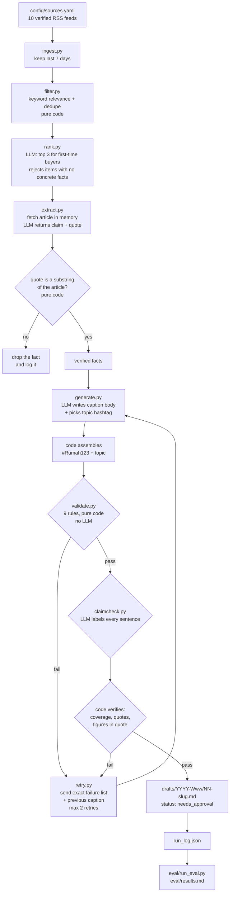

# Weekly IG Post Generator for Rumah123

Turns the week's Indonesian property news into Instagram caption drafts for
first-time home buyers aged 25 to 34 in Greater Jakarta.

Every caption is grounded in a quote from a real article, checked by code, and
left as a draft with status `needs_approval`. Nothing is posted anywhere.

## What it does

Once a week it reads Indonesian property and personal-finance RSS feeds, picks
the three stories most useful to a first-time buyer, pulls the verifiable facts
out of each article, writes three caption variants per story in Indonesian, and
rejects any caption whose figures are not in the verified facts.

Output is a markdown draft per story in `drafts/YYYY-Www/`, plus a
`run_log.json` recording what actually happened, and `eval/results.md` scoring
the run.

## Architecture



## Why validation is code and not an LLM self-check

Every rule that can be checked mechanically is checked mechanically. The model
is never asked whether its own caption obeys the rules.

The reason is concrete. In earlier prompt-engineering work the model reported a
word count of 79 for a caption that was actually about 89 words. A model asked
to audit itself will agree with itself. So counting, quote verification and
number grounding live in `src/validate.py` and `src/textutil.py`, where they
are deterministic and unit-tested.

The LLM is used for the four things that genuinely need judgement: ranking,
extracting candidate facts, writing Indonesian copy, and reading a caption
sentence by sentence. Everything it returns is then verified:

| The model says | Code verifies |
| --- | --- |
| here is a supporting quote | the quote is a substring of the fetched article |
| this caption is 85 words | counts whitespace tokens after removing hashtags |
| this claim is supported | the cited quote exists in the verified facts |
| this claim is supported | every figure in the claim appears in that quote |
| this sentence is just voice | re-checks it for digits, institutions, trend verbs |
| here are the caption's claims | the sentences returned cover the whole caption |

This caught real errors during development. The claim check marked a sentence
supported while citing a quote that did not exist in the facts, and it labelled
`"Bank Indonesia menahan suku bunga."` as non-factual voice. Both were rejected
by code, not by a better prompt.

## Setup

Python 3.11 or newer. Developed on 3.12.2.

```bash
python3 -m venv .venv
.venv/bin/python -m pip install -r requirements.txt

cp .env.example .env
# edit .env:
#   OPENAI_API_KEY=sk-...
#   OPENAI_MODEL=gpt-4.1-mini
```

`.env` is gitignored. Put real values there and never in `.env.example`, which
is tracked. A test fails if a key ever appears in the template.

The model is not hardcoded anywhere in `src/`. It is read from `OPENAI_MODEL`,
and `test_no_model_name_is_hardcoded_in_src` asserts that.

### Why this model

All ten candidate models on the key were probed with a real strict
`json_schema` call before choosing. Every one supported it. `gpt-4.1-mini` was
chosen because it is the cheap tier, returned 10 output tokens for a trivial
answer where the `gpt-6` family and `o3` returned 47 to 95 (they bill internal
reasoning as output, so cost per call is higher and less predictable), and the
4.1 family follows literal-copy instructions well, which is what the quote
extraction step depends on.

## How to run

```bash
.venv/bin/python -m pytest -q          # 322 tests, no API key needed
.venv/bin/python -m src.run            # the pipeline, needs the API key
.venv/bin/python eval/run_eval.py      # scores run_log.json into eval/results.md

# seeded-error test of the checking layers, needs the API key
.venv/bin/python eval/seeded_eval.py --repeats 3
.venv/bin/python eval/seeded_eval.py --render-only   # re-render, no API calls
```

`src.run` takes `--max-items`, `--variants` and `--max-retries` to control
cost. Defaults are 3, 3 and 2.

## Outputs

- `drafts/YYYY-Www/NN-slug.md` — one file per story: every passing caption
  variant, an image text suggestion, the source name and URL, the verified
  facts with their supporting quotes, the full validation result including
  failures, and `status: "needs_approval"`.
- `run_log.json` — timestamp, every feed fetched or failed, item counts at each
  step, the model, a sha256 of each prompt file, every attempt with its exact
  failure list, and token usage.
- `eval/results.md` — first-attempt pass rate against pass rate after retries,
  counts per failure type, and every failing case.
- `eval/results_run5.md` — the archived run before the hedge, superlative and
  block rules, kept so the before and after are both visible.
- `eval/seeded_results.md` and `eval/seeded_run.json` — the seeded-error test
  and its raw trial data.
- `review/YYYY-Www.md` — the hand review of a week's approved captions, with a
  verdict and the edited text where one was needed. Written by a human after
  reading the drafts, not generated.

Variants carry stable IDs `A`, `B` and `C`, derived from the variant index, so
the same variant has the same label in the draft heading, the draft front
matter, the validation results, `run_log.json` and the eval. Numbering only
the passing variants meant a variant changed label depending on what passed.

## The real runs

Two runs are reported, before and after the hedge, superlative and block
rules were added. Both are real, both are in the repo: run 5 is archived as
`eval/results_run5.md` and run 6 is `eval/results.md`, generated from the
`run_log.json` that is committed here.

**Both runs read the same week of news.** The feeds were fetched on
2026-11-07 and returned the same 555 items, the same 43 relevant and the same
37 after dedupe. The comparison therefore isolates the effect of the new
rules, and it is not evidence about how the system behaves on a different
week. One week is the entire evidence base.

### Funnel, identical in both runs

| Step | Items |
| --- | --- |
| Fetched inside the 7 day window | 555 |
| After keyword relevance | 43 |
| After dedupe | 37 |
| Chosen by ranking | 3 |
| Drafts written | 3 |

10 of 10 feeds fetched successfully, 0 failed. 512 items rejected as
irrelevant, 6 dropped as retellings of a story already kept. Fact extraction
verified 16 facts and dropped 2 whose quote was not found in the fetched text.

### Pass rate, before and after

| Measure | Run 5 (before) | Run 6 (after) |
| --- | --- | --- |
| Variants attempted | 9 | 9 |
| Passed on the first attempt | 1 (11%) | 0 (0%) |
| Passed after retries | 7 (78%) | 6 (67%) |
| Never passed | 2 (22%) | 3 (33%) |
| Items with at least one approved caption | 3 of 3 | 3 of 3 |
| LLM calls | 41 | 45 |
| Total tokens | 85,223 | 104,018 |
| Duration | 98.8 s | 133.6 s |

**The pass rate went down.** That is the expected direction: three new rules
reject things the old pipeline accepted, so the same model clears a higher
bar less often. The run costs about 22% more tokens for one fewer approved
caption.

### What the new rules rejected

| Failure rule | Run 5 | Run 6 | New in run 6 |
| --- | --- | --- | --- |
| `unsupported_figure` | 4 | 6 | |
| `dropped_hedge` | - | 5 | yes |
| `mislabelled_claim` | 4 | 3 | |
| `unverifiable_claim` | 4 | 3 | |
| `unsupported_superlative` | - | 3 | yes |
| `unsupported_claim` | - | 2 | |
| `block_too_long` | - | 1 | yes |
| `missing_source` | - | 1 | |
| `sentence_coverage` | 1 | - | |
| `ungrounded_number` | 1 | - | |

The three new rules fired 9 times on things run 5 let through. Concretely,
run 5 shipped these and run 6 does not:

- `suku bunga KPR tidak berubah` from a fact that says `relatif stabil`
- `penurunan paling tajam` from a fact that only gives one figure as lower
  than another
- `akan mulai dibangun Januari 2027` from a fact that says `ditargetkan`
- three approved captions that were a single unbroken paragraph of 57, 71 and
  79 words

Run 6's approved captions keep the hedges instead: `Rusun Manggarai
direncanakan mulai dibangun Januari 2027` and `Sekitar 57 persen peminatnya`.

Whether 6 well-hedged captions beat 7 with four overstatements among them is
a judgement, not a number. The pass rate alone says the system got worse.

### Seeded-error test of the claim checker

A separate test, `eval/seeded_results.md`, measures the checking layers
directly: 10 captions with exactly one planted fault each plus 2 clean
controls, all built from one set of verified facts taken verbatim from the
real run. Each case is run 3 times, because the claim checker is not
deterministic.

| Measure | Result |
| --- | --- |
| Seeded errors caught in every repeat | 9 of 10 (90%) |
| Caught only in some repeats | 1 of 10 (`E07`, wrong attribution, 2 of 3) |
| Never caught | 0 of 10 |
| Controls flagged in any repeat | 0 of 2 |

Seven faults are caught deterministically by code. Three are caught by the
claim checker and nothing else, which is what justifies its cost: a sentence
merging two facts, a figure credited to the wrong institution, and an
invented claim.

`E07` is the most useful case in the set and the clearest weakness. No code
rule can notice that a Bank Indonesia figure has been credited to Badan Pusat
Statistik, so that check rests entirely on the claim checker, which caught it
twice out of three. The first two single passes over this set scored 10 of 10
and then 9 of 10, which is why the harness now repeats and reports per-case
counts rather than one number.

No prompt was changed in response to the seeded results.

The seeded set does not cover the error that the human review actually found.
There is no case in it where a verified quote carries a wrongly paraphrased
claim, so the claim checker was never tested against that failure mode, and
the 90% figure above says nothing about it. The one real example of it, the 57
percent misread, got past every check.

## Human review

`review/2026-W45.md` is a hand review of all six captions the pipeline
approved in run 6, with a verdict on each: approved, approved with edit, or
rejected.

Three of six were approved as generated or with a one-sentence edit. Three
were rejected, all for the same error.

Every finding in it came from reading output the gate had already marked
clean. No check failed on any of those six captions.

The worst case is worth stating here, because it bounds what the rest of this
README claims. All three approved captions for the Manggarai item say that 57
percent of interested buyers are aged 25 to 35. The article says the age range
is 25 to 35 and that about 57 percent of them are unmarried. The 57 percent
belongs to being unmarried, not to the age bracket. The quote was verified
correctly, character for character. The misreading was in the extractor's
own summary of that quote, which nothing verifies.

## Limitations

- **The claim check is an LLM and is imperfect.** Code verifies its quotes,
  its coverage and its figures, which catches fabricated evidence and skipped
  sentences. It cannot catch a wrong judgement where the model's evidence is
  real and its reasoning is subtly wrong.
- **RSS coverage is limited, and worse than expected.** Every dedicated
  Indonesian property feed tried was unusable. Rumah123's own article feed
  returns 401, Kompas properti returns 404, housingestate and rumah.com parse
  with zero entries, and Liputan6 properti is 57 days stale. Kompas, Bisnis
  and Tempo return 403 to an honest user agent, and spoofing a browser was
  refused by design. Coverage therefore leans on general economy and finance
  feeds plus keyword filtering. All 29 rejected candidates are listed with
  their reason in `config/sources.yaml`.
- **One source dominates.** 8 of the 10 working feeds are general business
  desks, so most property items come from detikProperti. A week where
  detikProperti is quiet is a thin week.
- **Dedupe recall is partial.** Thresholds are calibrated on one week of real
  headlines. A cluster whose members share only one specific word is not
  merged, so the four IKN headlines in the test week all reached the ranker.
  A test documents this rather than asserting a recall the rule has not got.
- **Number grounding is strict on purpose and will reject reasonable copy.**
  A caption saying "naik 8 persen" against a verified "8,43 persen" fails, as
  does writing "Rp 294.000.000" for a verified "Rp 294 juta".
- **The superlative rule catches rhetorical uses too.** It blocks any of
  `paling, terbesar, tertinggi, terendah, selalu, pasti, tidak berubah,
  dijamin, semua, seluruh` unless the facts use that same word, including in
  the question to the reader. It rejected this project's own test fixture for
  asking "apa langkah pertama yang paling masuk akal?", which is not a factual
  claim at all. The fixture was changed rather than the rule, because a
  guarded word list that makes exceptions for sentences that look rhetorical
  is a judgement call, and judgement calls are what this layer exists to
  avoid. This is the rule most likely to annoy a copywriter.
- **The hedge rule matches sentences to facts by shared figures.** That is the
  only link available to pure code. A sentence that drops a hedge while
  citing no figure is not caught, and a figure that also appears in an
  unhedged fact carries no obligation, so a genuine dropped hedge can slip
  through when two facts share a number.
- **The extractor's claim is not verified, only its quote.** Each fact has a
  `quote` copied from the article, which code checks as a substring, and a
  `claim` written by the model, which nothing checks against that quote. A
  genuine quote can therefore carry a wrong summary. This is not theoretical:
  in run 6 a quote saying "rentang usia peminatnya 25-35 tahun dan sekitar 57
  persen di antaranya belum menikah" produced the claim "57 persen berusia
  25-35 tahun dan belum menikah", and all three approved captions for that
  item repeated it. The quote verified, the numbers matched, and the gate
  passed all three. See `review/2026-W45.md`.
- **The claim check only constrains numbers.** A caption sentence is checked
  for whether its figures appear in the supporting quote. A clause with no
  figure in it is not constrained, so a non-numeric claim riding alongside a
  numeric one passes. Run 6 variant B of item 1 said "mayoritas pembelian
  rumah dilakukan lewat KPR", dropping the "di pasar primer" that the fact
  specifies, which widens the claim beyond the survey. The 7,47 persen in the
  same sentence checked out, so the sentence passed.
- **Omissions are invisible to every check here.** Every rule asks whether
  what the caption says is supported. None asks whether what it leaves out
  matters. The approved FLPP caption gives the rate and the price ceiling and
  never mentions that FLPP has income eligibility limits, so a reader above
  the ceiling learns nothing that would tell them so. No rule in this
  repository can detect that, and none is planned, because it needs editorial
  judgement rather than a check.
- **Wrong attribution is the least reliable check.** Crediting a Bank
  Indonesia figure to BPS is invisible to every code rule, so it depends
  entirely on the claim checker, which caught it in 2 of 3 repeats on the
  seeded set. Treat attribution as something a human must verify.
- **The claim checker is not deterministic.** The same caption and the same
  facts can pass one minute and fail the next. Two single passes over the
  seeded set scored 10 of 10 and 9 of 10. Any single-run pass rate in this
  README is one sample, not a measurement.
- **No auto-posting, by design.** Output is a draft needing human approval.
  There is no Instagram integration and no plan for one.
- **No engagement data.** Nothing here knows which captions perform. The
  "best" variant is the one that passes the checks, not the one that works.
- **One week of evidence, and the same week every time.** Every pipeline run
  reported here read the news of 2026-11-07 and saw the same 555 items. The
  before and after comparison isolates the rules, but nothing here shows how
  the system behaves on a quiet week, a week dominated by one story, or a week
  where the property desks publish nothing with a number in it. The 67% pass
  rate is one sample from one week.

## What went wrong

1. The model kept dropping the hashtags. In one case it returned the exact
   same caption three times in a row.
2. My first retry did not show the model its own previous caption, so it could
   not keep what was already fine. Run 1 passed 0 of 9.
3. My dedupe rule never fired. I only found out when I tried it on real
   headlines.
4. Wrong claims like "paling tajam" and "tidak berubah" passed the gate. I
   only noticed them when I read the drafts, with Claude's help. That led to
   the hedge and superlative rule.
5. Two facts were thrown out because the model's quote was not exact.

What I learned: an LLM needs tests before I can trust it. The claim checker
was not stable, it caught one planted error only 2 times out of 3, so I would
not trust a single run.

### Where to verify each point

| Point | Evidence in this repo |
| --- | --- |
| 1 | Commit `0cb286b` message. The identical-caption case was run 3, whose log was overwritten. |
| 2 | Commit `0cb286b` message, and `src/generate.py` `build_user_message`, which now carries the previous caption. |
| 3 | Commit `c6b9d36` message, and `tests/test_filter.py::test_regression_sequence_threshold_is_reachable_in_practice`. |
| 4 | `git show 0cb286b:run_log.json` holds run 5. Both phrases appear in captions that **passed**: "paling tajam" in variant B of item 1, "tidak berubah" in variant C. Caught now by `tests/test_validate_hedges.py`. |
| 5 | `run_log.json`, `extraction[].dropped_detail`, reason `quote_not_found_in_article`. Same in run 5 and run 6. |
| Instability | `eval/seeded_results.md` and `eval/seeded_run.json`: `E07` caught 2 of 3. |

Runs 1 to 4 each overwrote `run_log.json` and were never committed, so points
1 and 2 are traceable only to commit messages rather than to a log file. Run 5
onwards is recoverable from git history.

### Also in the logs, not in the summary above

- Three bugs were found by writing the tests, before any API call. Number
  grounding compared substrings, so `"naik 8 persen"` passed against a
  verified `"8,43 persen"`. Banned-phrase matching compared substrings, so
  `cuan` was flagged inside `suku bunga acuan`. And the `123` in `Rumah123`
  was reported as an ungrounded number.
- Replacing the dedupe rule surfaced three further problems: counting all
  shared words equally fails when one story dominates a week (`manggarai`
  appeared in 10 of 43 titles, so it stopped looking rare); the relevance
  keywords had to be excluded, because including them merged an Australian
  house-price story with an Indonesian one; and the score had to be divided by
  log(N), or a threshold calibrated on a busy week stops firing on a quiet one.
- The generator named `Bank Indonesia`, an institution quoted inside the
  facts, instead of the publisher `CNN Indonesia` given as the source. Every
  caption in run 1 failed the source rule.
- The generator converted a verified `Rp 294 juta` into `Rp 294000000`, a
  figure appearing nowhere in the facts.
- The claim-check coverage gate rejected duplicated sentences, which the model
  produced intermittently in run 4. Skipping a sentence is the real risk; a
  sentence returned twice is still checked.
- `count_emoji` counted codepoints, so a flag counted as two emoji and a
  caption with one flag failed the max-one-emoji rule.
- A bare scale word was read as a quantity, so `"ratusan juta"` was reported
  as the number one million.
- The superlative rule immediately rejected this project's own test fixture,
  which asked "apa langkah pertama yang paling masuk akal?". The rule was kept
  and the fixture changed.
- Two seeded-error passes scored 10 of 10 and then 9 of 10 on identical
  inputs. Reporting either would have reported luck, which is why that harness
  repeats each case.
- A live API key was pasted into the tracked `.env.example`. It never reached a
  commit; `test_env_example_has_no_filled_in_key` caught it.

## GitHub Actions status

`.github/workflows/weekly.yml` runs on cron `0 1 * * 1`, which is 01:00 UTC
Monday and so 08:00 WIB Monday, plus `workflow_dispatch`. It uses the
`OPENAI_API_KEY` secret and an `OPENAI_MODEL` repository variable, and commits
`drafts/` with `GITHUB_TOKEN` under `permissions: contents: write`.

**The workflow has never been run.** At the time of writing nothing has been
pushed to the remote, so neither `weekly.yml` nor `tests.yml` has ever
executed, and no run has been observed to succeed. The cron expression was
verified only by computing that 01:00 UTC Monday is 08:00 WIB Monday. The
pipeline itself was run locally, which is where every number in this README
comes from.

## What I would change

- Allow a claim to cite more than one quote. `unverifiable_claim` is now a top
  failure type, and most cases are a sentence that correctly combines two
  verified facts but can only offer one quote.
- Find property sources that are not RSS. The dedicated feeds are dead, so a
  sitemap reader or a licensed API would do more for output quality than any
  prompt change.
- Cluster stories before ranking instead of deduping pairwise. The real unit is
  "the Manggarai story", not a headline, and a greedy pairwise pass cannot see
  that.
- Raise the first-attempt pass rate, now 0 of 9. Every variant needs at least
  one retry, which multiplies the cost of a run for no editorial gain. The
  generator is being asked to satisfy twelve rules at once from a prompt; some
  of them would be better applied as a deterministic repair, the way the
  hashtag line already is.
- Check the extractor's claim against its own quote. This is the single
  highest-value fix available: it is the gap that let the 57 percent misread
  through, and it is checkable, since the claim and the quote sit side by side
  in one object. A second call that only asks "is this claim a fair reading of
  this quote" would have caught it.
- Constrain non-numeric clauses, not only figures. Dropping "di pasar primer"
  changes what a sentence claims as much as changing a number would.
- Give the hedge rule something better than shared figures to match sentences
  to facts. Matching on numbers is what pure code can do, but it misses a
  hedge dropped from a sentence that cites no number.
- Grow the seeded set and have someone else write the cases. Ten cases written
  by the author of the rules measure whether the known guards fire, not
  whether the system is hard to fool.
- Run the pipeline across several different weeks before quoting any pass rate
  as a property of the system.
- Track which approved drafts a human actually posts, and feed that back. Right
  now the system optimises for passing its own checks, which is not the goal.
- Run the workflow and report its real status here.
