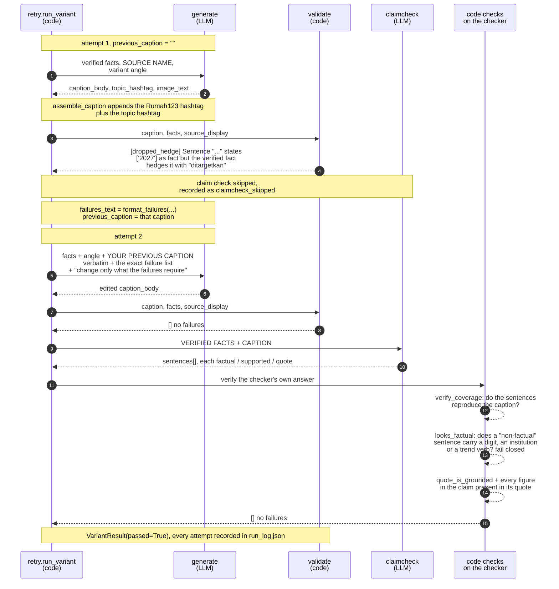

# Architecture

Written from the code in `src/`. Every component named here exists in the
repository, and the rule names are the strings the code actually emits.

There are 16 modules in `src/`, about 2,400 lines. Four of them make LLM calls
(`rank`, `extract`, `generate`, `claimcheck`). Everything else is deterministic
code.

- [Pipeline](#pipeline)
- [One item through the retry loop](#one-item-through-the-retry-loop)
- [Data contracts](#data-contracts)
- [Where each kind of error is caught](#where-each-kind-of-error-is-caught)
- [Not covered](#not-covered)

## Pipeline

Orchestrated by `src/run.py:main`. Blue is deterministic code, orange is an
LLM call, grey is output on disk, green is the human step.

```mermaid
flowchart TD
    CFG[/"config/sources.yaml<br/>config/rules.yaml<br/>prompts/*.md"/]:::cfg

    ING["<b>ingest.fetch_all</b><br/>fetch 10 RSS feeds<br/>keep items inside 7 days"]:::code
    REL["<b>filter.relevant</b><br/>keyword match on word boundaries<br/>title blocklist"]:::code
    DED["<b>filter.dedupe</b><br/>normalize_url, then<br/>titles_are_same_story:<br/>sequence ratio OR rarity score"]:::code

    RANK["<b>rank.rank</b><br/>top 3 for first-time buyers<br/>rejects has_concrete_facts false"]:::llm

    FETCH["<b>extract.fetch_text</b><br/>trafilatura, in memory only<br/>article text never written to disk"]:::code
    EX["<b>extract.extract</b><br/>returns facts as claim + quote"]:::llm
    QV{"<b>quote_is_grounded</b><br/>is the quote a substring<br/>of the fetched article?"}:::code
    DROP["drop the fact<br/>log quote_not_found_in_article"]:::code

    GEN["<b>generate.generate</b><br/>writes caption_body<br/>+ picks topic_hashtag"]:::llm
    ASM["<b>generate.assemble_caption</b><br/>strips stray hashtags<br/>appends #Rumah123 + topic"]:::code
    VAL{"<b>validate.validate</b><br/>16 rules, no LLM"}:::code
    CC["<b>claimcheck.check</b><br/>labels every sentence<br/>factual / non-factual"]:::llm
    CCV{"<b>code checks the checker</b><br/>verify_coverage<br/>looks_factual fail-closed<br/>quote + figures in quote"}:::code
    RETRY["<b>retry.run_variant</b><br/>send exact failure list<br/>+ previous caption<br/>max 2 retries"]:::code

    DRAFT["<b>draft.write_draft</b><br/>drafts/YYYY-Www/NN-slug.md<br/>status needs_approval"]:::out
    LOG["<b>run.write_logs</b><br/>run_log.json<br/>+ run_log_&lt;timestamp&gt;.json"]:::out
    EV["<b>eval/run_eval.py</b><br/>eval/results.md"]:::out
    HUM["<b>human review</b><br/>review/YYYY-Www.md<br/>approve / approve with edit / reject"]:::human

    CFG --> ING
    ING -->|"555 items"| REL
    REL -->|"43 kept, 512 rejected"| DED
    DED -->|"37 kept, 6 same_story"| RANK
    RANK -->|"3 items"| FETCH
    FETCH --> EX
    EX --> QV
    QV -->|no| DROP
    QV -->|yes| GEN
    GEN --> ASM
    ASM --> VAL
    VAL -->|"fail"| RETRY
    VAL -->|"pass"| CC
    CC --> CCV
    CCV -->|"fail"| RETRY
    RETRY -->|"retry budget left"| GEN
    RETRY -->|"budget spent"| DRAFT
    CCV -->|"pass"| DRAFT
    DRAFT --> LOG
    LOG --> EV
    DRAFT --> HUM

    classDef code fill:#dbeafe,stroke:#1e40af,color:#1e3a8a
    classDef llm fill:#fed7aa,stroke:#c2410c,color:#7c2d12
    classDef out fill:#e5e7eb,stroke:#4b5563,color:#1f2937
    classDef human fill:#dcfce7,stroke:#15803d,color:#14532d
    classDef cfg fill:#fef9c3,stroke:#a16207,color:#713f12
```



Counts on the arrows are from the run in `run_log.json`, 2026-11-07.
Rendered copy: [`architecture.svg`](architecture.svg).

Two things the diagram makes visible. The LLM is never the last word: every
orange box is followed by a blue one that checks it. And the claim check is
only reached when `validate` passes, because `retry.run_variant` runs the free
deterministic checks first so a caption that fails them costs no API call.

## One item through the retry loop

`retry.run_variant` for one variant. The loop runs at most
`max_retries + 1 = 3` times.



Rendered copy: [`retry-loop.svg`](retry-loop.svg).

What goes back to the generator on a failure is the whole point of this loop,
and it was wrong at first. `generate.build_user_message` sends three things:
the verified facts, the previous caption verbatim, and `format_failures`
output, which is one bullet per failure, each already specific enough to act
on. Before the previous caption was included, the model rewrote from scratch
and lost parts that were already correct.

## Data contracts

### `Fact` — `src/models.py`

The central object. Everything downstream is checked against it.

| Field | Type | Meaning |
| --- | --- | --- |
| `claim` | `str` | The fact in the extractor's own words, in Indonesian. **Not verified against the quote.** See [Not covered](#not-covered). |
| `quote` | `str` | A span copied from the article. Verified by `quote_is_grounded` as a substring of the fetched text, comparing on normalised whitespace. Dropped if not found, if shorter than 5 characters, or if longer than 300. |

### `Caption` — `src/models.py`

| Field | Type | Meaning |
| --- | --- | --- |
| `caption` | `str` | The assembled caption: the model's `caption_body` with stray hashtags stripped, plus a final line of `#Rumah123` and one topic hashtag. The model does not write this field directly. |
| `image_text` | `str` | A short headline for the graphic, max 8 words. Carried into the draft. Not validated by any rule. |

The generator's JSON schema (`GENERATE_SCHEMA`) asks for `caption_body`,
`topic_hashtag` and `image_text`. `generate.generate` turns those into a
`Caption`.

### `Failure` — `src/validate.py`

The real class name is `Failure`, not `ValidationFailure`. Both `validate` and
`claimcheck` return lists of it, so a failure from either layer is the same
shape and the retry loop treats them identically.

| Field | Type | Meaning |
| --- | --- | --- |
| `rule` | `str` | Machine-readable rule id, used for counting in `eval/run_eval.py`. There are 23 distinct values: 16 from `validate`, 6 from `claimcheck`, 1 from `retry`. |
| `message` | `str` | One sentence naming what is wrong and what to do about it. This text is what goes back to the generator. |

`__str__` renders as `[rule] message`. `format_failures` joins a list into
bullets.

Rules from `validate` (deterministic): `word_count`, `hashtag_count`,
`required_hashtag`, `topic_hashtag`, `emoji_count`, `em_dash`, `semicolon`,
`en_dash`, `banned_phrase`, `missing_source`, `ungrounded_number`,
`ungrounded_number_word`, `unsupported_superlative`, `dropped_hedge`,
`block_structure`, `block_too_long`.

Rules from `claimcheck` (LLM answer, verified by code): `sentence_coverage`,
`mislabelled_claim`, `unsupported_claim`, `unverifiable_claim`,
`unsupported_figure`, plus `claimcheck` when there are no facts to check
against and `claimcheck_error` raised by `retry` when the call itself fails.

### `run_log.json` — `src/runlog.py` and `src/run.py`

Written to `run_log.json` and to `run_log_<timestamp>.json`.

| Key | Meaning |
| --- | --- |
| `run_started_utc`, `run_finished_utc`, `duration_seconds` | When and how long. |
| `model` | The model id, read from `OPENAI_MODEL`. Never hardcoded in `src/`. |
| `prompt_versions` | First 16 hex of the sha256 of each file in `prompts/`, so a result can be tied to the prompt that produced it. |
| `feeds_ok` | Per feed: `name`, `url`, `entries`, `kept_in_window`, `skipped_no_date`. |
| `feeds_failed` | Per feed: `name`, `url`, `error`. Empty in the recorded run. |
| `counts` | `fetched_in_window`, `after_relevance`, `after_dedupe`, `after_ranking`, `drafts_written`. |
| `relevance_rejected` | How many items the keyword filter dropped. |
| `dedupe_dropped` | Per dropped item: `reason`, `duplicate_of`, `duplicate_of_title`, `sequence_ratio`, `rarity_score`, `shared_specific_words`. |
| `ranking` | Per ranked item: `index`, `url`, `title`, `score`, `kept`, `reason`. |
| `extraction` | Per item: `url`, `title`, `article_chars`, `facts_kept`, `facts_dropped`, `dropped_detail` with the reason each fact was discarded. |
| `items[]` | Per item: `url`, `title`, `source`, `facts_verified`, `facts_dropped`, `variants_passing`, `draft`, and `variants[]`. |
| `items[].variants[]` | `variant_index`, `variant_id` (A, B, C), `passed`, `first_attempt_passed`, `attempts[]`. |
| `items[].variants[].attempts[]` | `attempt`, `caption`, `image_text`, `validation_failures`, `claimcheck_failures`, `claimcheck_detail`, `claimcheck_skipped`, `failures`, `failure_rules`. |
| `tokens` | `calls`, `prompt_tokens`, `completion_tokens`, `total_tokens`. |
| `errors`, `status` | Accumulated errors and one of `ok`, `no_items`, `no_relevant_items`, `rank_failed`, `no_drafts`, `incomplete`. |

The full article text is never recorded. `extraction[].article_chars` keeps the
length only.

`src/models.py` also defines `ClaimCheckResult`, which nothing imports. It is
left over from claim check v1 and is dead code.

## Where each kind of error is caught

Every example below is from a real run. Most are traceable to a committed
artifact: `run_log.json` (run 6), `git show 0cb286b:run_log.json` (run 5),
`eval/seeded_run.json` (the seeded test) or `review/2026-W45.md`. Runs 1 to 4
overwrote `run_log.json` and were never committed, so the two examples drawn
from them are marked as such and traceable only to commit messages.

| Error type | Real example | Caught by |
| --- | --- | --- |
| Invented or altered number | `194.000 rumah` written for a verified `194.360` (run 5). Run 1 turned a verified `Rp 294 juta` into `Rp 294000000`, though that log was never committed, see commit `0cb286b` | **Code** — `ungrounded_number`, compares complete numeric tokens |
| Number rounded | `naik 8 persen` against a verified `8,43 persen` | **Code** — `ungrounded_number` |
| Number written in words | `naik delapan persen` against `8,43 persen` | **Code** — `ungrounded_number_word`, unit-aware |
| Superlative the facts do not make | `penurunan paling tajam`, from a fact giving only a figure | **Code** — `unsupported_superlative` |
| Certainty the facts do not have | `suku bunga tidak berubah` from a verified `relatif stabil` | **Code** — `unsupported_superlative` |
| Hedge dropped | `akan mulai dibangun Januari 2027` from a verified `ditargetkan` | **Code** — `dropped_hedge` |
| Missing or wrong hashtags | The model omitted the hashtag line on about half of attempts across runs 1 to 3, whose logs were not committed, see commit `0cb286b` | **Unreachable** — the line is assembled by `generate.assemble_caption`, so the model can no longer get it wrong |
| Wall of text | Three approved captions in run 5 were single paragraphs of 57, 71 and 79 words | **Code** — `block_structure`, `block_too_long` |
| Fabricated supporting quote | Claim marked supported citing a quote absent from the facts | **Code** — `unverifiable_claim`, `quote_is_grounded` |
| Figure not in its own quote | `FLPP ... bunga tetap 5 persen` cited against a quote without the 5 | **Code on the LLM's answer** — `unsupported_figure` |
| Claim sentence skipped by the checker | Run 5: the checker returned 6 sentences covering 335 of the caption's 380 characters, leaving the closing question unchecked | **Code on the LLM's answer** — `sentence_coverage` |
| Fact hidden in a hook or question | `Kamu lihat harga rumah naik...` labelled non-factual | **Code on the LLM's answer** — `mislabelled_claim`, fail-closed |
| Two facts merged into one sentence | `harga ... 0,58 persen sementara penjualan ... 8,43 persen` | **LLM** — `unverifiable_claim`, no single quote supports it |
| Claim with no basis in the facts | `Pemerintah akan menurunkan bunga KPR subsidi mulai tahun depan` | **LLM** — `unsupported_claim` |
| Figure credited to the wrong institution | A Bank Indonesia figure attributed to Badan Pusat Statistik | **LLM, unreliably** — caught in 2 of 3 repeats in the seeded test. No code rule can see it |
| Extractor's claim misreads its own quote | A quote saying the age range is 25-35 and that ~57 percent of them are unmarried became the claim `57 persen berusia 25-35 tahun`. All three approved captions repeated it | **Human only** — the quote verified, the figure matched, the gate passed all three |
| Scope quietly widened | `mayoritas pembelian rumah dilakukan lewat KPR`, dropping the `di pasar primer` the fact specifies | **Human only** — the clause carries no figure, and only figures are constrained |
| Material omission | The approved FLPP caption never mentions FLPP's income eligibility limits | **Nobody** — every rule asks whether what is said is supported, none asks whether what is missing matters |

Counting the rows: 12 kinds are caught deterministically or made unreachable,
3 depend on the LLM and one of those is unreliable, 2 were caught only by a
person reading the output, and 1 is caught by nothing.

## Not covered

These match the Limitations section of the README.

- **The extractor's `claim` is never verified against its `quote`.** A genuine
  verified quote can carry a wrong summary, and the generator writes from the
  claim. This is the gap the 57 percent misread went through.
- **Only figures are constrained.** A clause with no number in it is not
  checked, so a non-numeric claim can ride alongside a numeric one.
- **Omissions are invisible.** No rule asks what a caption left out.
- **Wrong attribution rests entirely on the LLM**, which caught it in 2 of 3
  repeats on the seeded set.
- **The claim checker is not deterministic.** The same caption and facts can
  pass once and fail the next time. Any single-run pass rate is one sample.
- **The hedge rule matches sentences to facts by shared figures**, which is the
  only link available to pure code. A hedge dropped from a sentence citing no
  figure is not caught.
- **The superlative rule is strict and catches rhetorical uses**, including in
  the question to the reader.
- **`image_text` is not validated** by any rule, though the prompt constrains
  it.
- **One week of evidence.** Every run reported anywhere in this repository read
  the news of 2026-11-07.
- **No auto-posting and no engagement data**, by design. The system optimises
  for passing its own checks, which is not the same as working.

## Rendering these diagrams

The two SVGs in this directory were generated from the Mermaid blocks above
with `@mermaid-js/mermaid-cli`:

```bash
npx -y @mermaid-js/mermaid-cli -i diagram.mmd -o docs/architecture.svg -b white
```

They are committed so the diagrams are viewable without a Mermaid renderer.
If a block above changes, regenerate the matching SVG.
